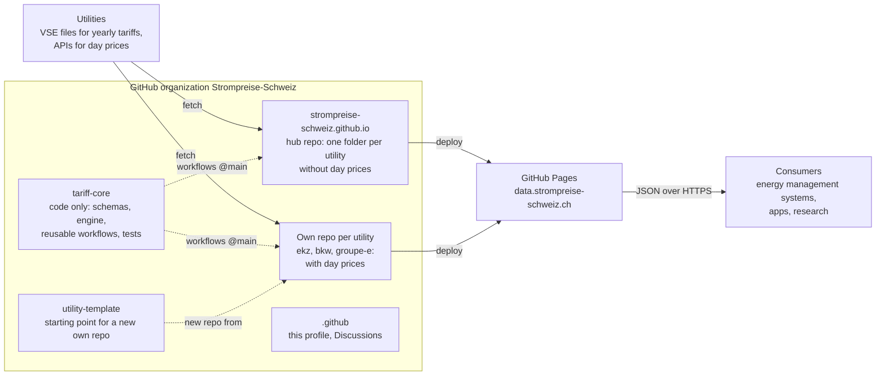

# Strompreise Schweiz – Swiss Electricity Tariffs (Open Data)

Swiss electricity tariffs in one schema, validated, with full history: constant, multilevel and dynamic.

## Why

Tariff data is already published in several places:

- [ElCom](https://www.elcom.admin.ch/tarifdaten-und-visualisierungen) publishes prices per grid operator as linked data on
  [LINDAS](https://lindas.admin.ch/), queried with SPARQL. For each operator it also links to the
  operator's machine-readable tariff file.
- Utilities publish these files as JSON in the format of the [VSE](https://www.strom.ch), each on its own server.
- [SmartGridready](https://smartgridready.ch/loesungen/dynamischetarife) lists utilities with dynamic tariffs.

To use this data, for example in an energy management system, you need files that follow one schema,
can be fetched the same way for every utility, and can be traced back: what did a utility publish
yesterday for today's dynamic tariff? The original sources answer only the current state, each in its own way.

This organization collects the data and publishes it that way:

- **One schema.** Published files stay valid VSE files. Additions are only additive.
- **What you pay.** A tariff file lists energy, grid, metering and fees separately. A product puts
  them together, as a price sheet does: the standard product of a household, per month and per kWh.
- **Validated.** Every change is checked against JSON Schemas and semantic rules (time coverage, product references).
- **Traceable.** Each file is stored in Git. Every change has a date and a diff, and dynamic tariffs are archived per day.
- **Cheap to run.** No server. GitHub Actions fetches and validates, files are served from stable URLs.
- **Open.** Anyone can read the code, report errors, propose changes and discuss in public.

## Repositories

### [`tariff-core`](https://github.com/Strompreise-Schweiz/tariff-core): the engine

The central repository. It holds everything the utility repos share: the schemas, the validation,
the engine that fetches, normalizes and publishes tariffs, the reusable GitHub Actions workflows and
the tests. It contains code only, no tariff data. A fix here applies to every utility at once.

### The data: hub repo or own repo

The data repos contain no code, only configuration, manual corrections and the generated data. They
call the workflows of `tariff-core`. Each utility lives in exactly one of them:

- **[`strompreise-schweiz.github.io`](https://github.com/Strompreise-Schweiz/strompreise-schweiz.github.io), the hub repo:**
  all utilities with constant and multilevel tariffs only, one folder each. These tariffs change about
  once a year, so one weekly run checks all of them, and corrections arrive as pull requests. This is
  where most utilities live, maintained by this project.
- **Own repo, named after the utility,** for example [`ekz`](https://github.com/Strompreise-Schweiz/ekz),
  [`bkw`](https://github.com/Strompreise-Schweiz/bkw) and [`groupe-e`](https://github.com/Strompreise-Schweiz/groupe-e):
  utilities with dynamic tariffs, or that maintain their data themselves. Dynamic tariffs change daily,
  so they are fetched every evening and archived per day. An own repo holds all tariffs of its utility,
  including the constant and multilevel ones.

### One address for everything

The hub repo is also the website of the organization on GitHub Pages and serves all utilities under
one domain, whether they live in the hub or in their own repo:

- [`data.strompreise-schweiz.ch/index.json`](https://data.strompreise-schweiz.ch/index.json): every utility
- `data.strompreise-schweiz.ch/<utility>/index.json`: all URLs of one utility, for example
  [EKZ](https://data.strompreise-schweiz.ch/ekz/index.json)
- `data.strompreise-schweiz.ch/<utility>/products/standard/<year>.json`: what a household in the basic
  supply pays, every component and the total, where the standard product is defined, for example
  [EKZ 2026](https://data.strompreise-schweiz.ch/ekz/products/standard/2026.json)
- [`data.strompreise-schweiz.ch/status.html`](https://data.strompreise-schweiz.ch/status.html): what the checks found for every utility

A utility can move between the hub and an own repo without any of these URLs changing. See
[stable URLs](https://github.com/Strompreise-Schweiz/tariff-core/blob/main/docs/stable-urls.md) for details.

### How the data stays current

Each data repo runs a few short workflows. They only name a trigger and call the matching reusable
workflow of `tariff-core`, which does the work. New data is committed, and each commit deploys the site.

| When | Workflow in the data repo | Reusable workflow in `tariff-core` | Result in `data/` |
|---|---|---|---|
| Every evening at 18:35, 20:05 and 22:05 Swiss time, or by hand. Own repos only | `update-prices.yml` | `reusable-update.yml`: `fetch.ts --prices`, `build.ts`, commit | the day prices: `sources/days/`, `tariffs/<year>/<tariff>/`, `products/<id>/<year>/`, today and tomorrow in `tariffs/current/` and `products/<id>/latest.json` |
| Mondays 06:20, daily from 1 to 15 September, after a push to `curation/` or `config/`, or by hand | `update-tariffs.yml` | `reusable-update.yml`: `fetch.ts --tariffs`, `build.ts`, commit | the yearly files: `sources/<name>.json`, `tariffs/<year>.json`, `products/<id>/<year>.json`, `checks.json`, `index.json` |
| Each push and pull request | `validate.yml` | `reusable-validate.yml`: `validate.ts` | passes or fails, no commit |
| After a push to `data/` or an update run | `pages.yml` | `reusable-pages.yml`: `build-site.ts`, deploy | `data.strompreise-schweiz.ch/<utility>/` |

Every data repo calls the reusable workflows of `tariff-core` from `main`, so a fix there applies to
every utility at once. The hub repo has no `update-prices.yml`: day prices commit every day and belong
in an own repo.

### Other repositories

| Repository | Purpose |
|---|---|
| [`utility-template`](https://github.com/Strompreise-Schweiz/utility-template) | Starting point for a utility with its own repo |
| [`.github`](https://github.com/Strompreise-Schweiz/.github) | This profile and the [Discussions](https://github.com/orgs/Strompreise-Schweiz/discussions) |

## Technology and skills

- **TypeScript** on **Node.js** (`ajv` for JSON Schema) for fetching, normalizing and validating
- **JSON Schema** and the **VSE OpenAPI definition** for the formats
- **GitHub Actions** for scheduling, **Git** for history, **GitHub Pages** for serving
- **Domain knowledge** of Swiss tariffs: energy, grid, metering and fees, price sheets, clock changes

Help is welcome in any of these, also without writing code: checking tariffs against price sheets
is as valuable as improving the engine.

## Open data

Tariff data is published under [CC BY 4.0](https://creativecommons.org/licenses/by/4.0/), one of the licenses
in the [DCAT-AP CH vocabulary](https://www.dcat-ap.ch/vocabulary/licenses/20240716.html): free use, including
commercial use, as long as the source is named. Nobody has to ask for permission first. The code is licensed under MIT.

Logos and brand names remain the property of their owners and are not covered by these licenses.

## Contributing

- **Utilities** can send their tariffs or corrections, and this project publishes them in the hub repo.
  Utilities that want to maintain their data themselves get their own repository.
- **Developers and energy experts** can improve schemas, validation and tools, or build on the data.

Questions and ideas go to [Discussions](https://github.com/orgs/Strompreise-Schweiz/discussions) or
info@strompreise-schweiz.ch. The website [www.strompreise-schweiz.ch](https://www.strompreise-schweiz.ch)
lists the available datasets.
